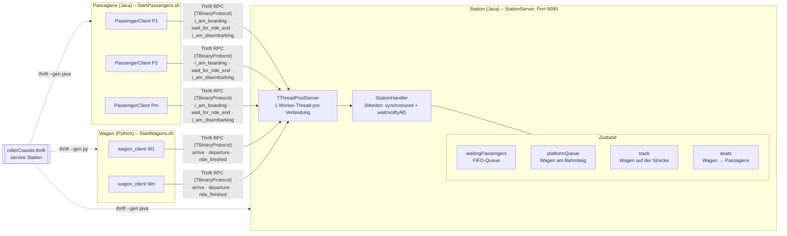

# Roller Coaster

Verteilte Achterbahn-Simulation mit Apache Thrift:

- **Station** (Java) – Server, koordiniert Wagen und Passagiere
- **Passagiere** (Java) – `rollerCoaster.PassengerClient`
- **Wagen** (Python) – `src/python/wagon_client.py`

## Architektur

### Komponenten



Alle Clients sprechen mit **einer** `StationHandler`-Instanz. Blockierende Calls (z. B. `i_am_boarding`, `arrive`) hängen serverseitig in `wait()`, bis ihre Bedingung erfüllt ist – der Client wartet einfach auf die RPC-Antwort.

## Projektstruktur

```
rollerCoaster.thrift      Schnittstellendefinition
src/rollerCoaster/        Java-Code (StationServer, StationHandler, PassengerClient)
src/python/               Python-Code (wagon_client.py)
gen-java/, gen-py/        von Thrift generierter Code (nicht von Hand bearbeiten)
build/                    kompilierte Java-Klassen
lib/                      Java-Abhängigkeiten (libthrift, slf4j)
logs/                     Logs der Wagen und Passagiere
```

## Voraussetzungen

- Java 21 (JDK)
- Python 3 mit venv
- Apache Thrift Compiler 0.22.0

## Setup

### Python-Umgebung
```shell
python3 -m venv .venv
.venv/bin/pip install -r requirements.txt
```

### Code generieren
```shell
thrift --gen java --gen py rollerCoaster.thrift
```

### Java kompilieren
```shell
javac -cp "lib/*" -d build src/rollerCoaster/*.java gen-java/rollerCoaster/*.java
```

## Starten

### Station (Terminal 1)
```shell
java -cp "build:lib/*" rollerCoaster.StationServer 4
```

### Wagen (Terminal 2)
```shell
./StartWagons.sh localhost 4
```
Nutzung: `./StartWagons.sh <stationHost> <anzahl> [fahrzeitMs]`

### Passagiere (Terminal 3)
```shell
./StartPassengers.sh localhost 10
```
Nutzung: `./StartPassengers.sh <stationHost> <anzahl>`

### Live-Logs (Terminal 3 oder 4)
```shell
tail -F logs/*.log
```

## Aufräumen

```shell
pkill -f rollerCoaster.PassengerClient; pkill -f wagon_client.py
rm -f logs/*.log
```
