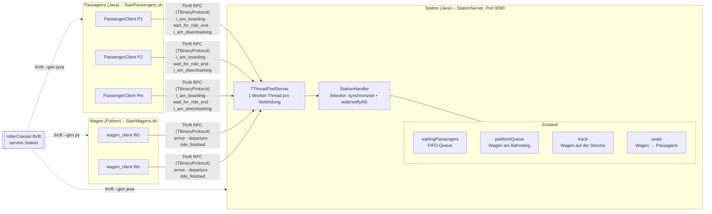
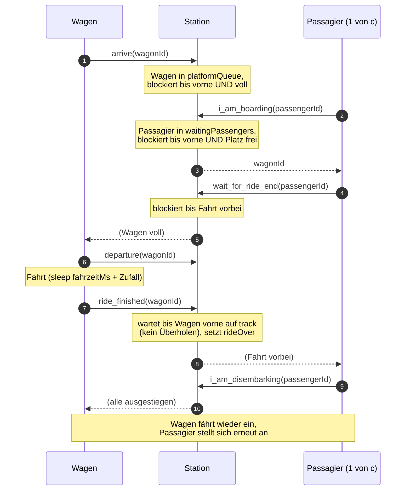

# Roller Coaster

Verteilte Achterbahn-Simulation mit Apache Thrift:

- **Station** (Java) – Server, koordiniert Wagen und Passagiere
- **Passagiere** (Java) – `rollerCoaster.PassengerClient`
- **Wagen** (Python) – `src/python/wagon_client.py`

## Architektur

### Komponenten



Alle Clients sprechen mit **einer** `StationHandler`-Instanz. Blockierende Calls (z. B. `i_am_boarding`, `arrive`) hängen serverseitig in `wait()`, bis ihre Bedingung erfüllt ist – der Client wartet einfach auf die RPC-Antwort.

### Ablauf einer Fahrt (Kapazität c)



## Projektstruktur

```
rollerCoaster.thrift      Schnittstellendefinition
src/rollerCoaster/        Java-Code (StationServer, StationHandler, PassengerClient)
src/python/               Python-Code (wagon_client.py)
gen-java/, gen-py/        von Thrift generierter Code (nicht von Hand bearbeiten)
build/                    kompilierte Java-Klassen
lib/                      Java-Abhängigkeiten (libthrift, slf4j)
logs/                     Logs der Wagen und Passagiere
Start*.sh / Start*.cmd    Startskripte für Linux/WSL bzw. Windows (.cmd ruft .ps1 auf)
```

## Voraussetzungen

- Java 21 (JDK)
- Python 3 mit venv
- Apache Thrift Compiler 0.22.0

## Setup

### Python-Umgebung
```shell
python3 -m venv .venv
.venv/bin/pip install -r requirements.txt
```

### Code generieren
```shell
thrift --gen java --gen py rollerCoaster.thrift
```

### Java kompilieren
```shell
javac -cp "lib/*" -d build src/rollerCoaster/*.java gen-java/rollerCoaster/*.java
```

## Starten

### Station (Terminal 1)
```shell
java -cp "build:lib/*" rollerCoaster.StationServer 4
```

### Wagen (Terminal 2)
```shell
./StartWagons.sh localhost 4
```
Nutzung: `./StartWagons.sh <stationHost> <anzahl> [fahrzeitMs]`

### Passagiere (Terminal 3)
```shell
./StartPassengers.sh localhost 10
```
Nutzung: `./StartPassengers.sh <stationHost> <anzahl>`

### Live-Logs (Terminal 3 oder 4)
```shell
tail -F logs/*.log
```

## Aufräumen

```shell
pkill -f rollerCoaster.PassengerClient; pkill -f wagon_client.py
rm -f logs/*.log
```

## Windows (nativ, ohne WSL)

WSL2 hängt standardmäßig hinter einem eigenen virtuellen Netzwerk (NAT), daher ist eine Station in WSL von anderen Rechnern aus nicht erreichbar. Nativ unter Windows besteht dieses Problem nicht. Der Code bleibt gleich; der generierte Thrift-Code liegt im Repo, der Thrift-Compiler wird also nicht benötigt.

### Voraussetzungen
```powershell
winget install EclipseAdoptium.Temurin.21.JDK
winget install Python.Python.3.12
```
Das Repo unter Windows klonen (z. B. nach `C:\...`, nicht ins WSL-Dateisystem).

### Setup (PowerShell, im Projektordner)
```powershell
# Python-Umgebung
py -m venv .venv
.venv\Scripts\pip install -r requirements.txt

# Java kompilieren (unter Windows ';' statt ':' im Classpath)
javac -cp "lib\*" -d build src\rollerCoaster\*.java gen-java\rollerCoaster\*.java
```

### Starten
```powershell
# Terminal 1 – Station
java -cp "build;lib\*" rollerCoaster.StationServer 4

# Terminal 2 – Wagen
.\StartWagons.cmd localhost 4

# Terminal 3 – Passagiere
.\StartPassengers.cmd localhost 10

# Live-Logs
Get-Content logs\*.log -Wait
```
Nutzung: `.\StartWagons.cmd <stationHost> <anzahl> [fahrzeitMs]` bzw. `.\StartPassengers.cmd <stationHost> <anzahl>`

Die `.cmd`-Dateien rufen die gleichnamigen `.ps1`-Skripte mit `-ExecutionPolicy Bypass` auf. So gibt es keinen Fehler „Ausführung von Skripts auf diesem System deaktiviert“. Wer die `.ps1` direkt starten will, muss einmalig die Execution Policy lockern (bei heruntergeladenen Dateien zusätzlich `Unblock-File`):
```powershell
Set-ExecutionPolicy -Scope CurrentUser RemoteSigned
Get-ChildItem *.ps1 | Unblock-File
```

### Verteilt über mehrere Rechner
- IP des Station-Rechners mit `ipconfig` ermitteln; die anderen starten ihre Skripte mit dieser IP statt `localhost`.
- **Windows-Firewall:** Beim ersten Start der Station Java den Zugriff für „Private Netzwerke“ erlauben, oder als Admin:
  ```powershell
  New-NetFirewallRule -DisplayName "RollerCoaster 9090" -Direction Inbound -Protocol TCP -LocalPort 9090 -Action Allow
  ```
- Das Netzwerkprofil in Windows muss „Privat“ sein, nicht „Öffentlich“.

### Aufräumen
```powershell
Get-CimInstance Win32_Process | ? { $_.CommandLine -like '*PassengerClient*' -or $_.CommandLine -like '*wagon_client.py*' } | % { Stop-Process -Id $_.ProcessId }
Remove-Item logs\*.log
```

### Alternative: in WSL bleiben
In `%USERPROFILE%\.wslconfig` eintragen und danach `wsl --shutdown` ausführen. WSL teilt dann die Netzwerkadressen mit Windows (die Firewall-Regel von oben wird trotzdem benötigt):
```ini
[wsl2]
networkingMode=mirrored
```
